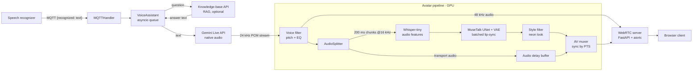

# OLA — Real-Time AI Avatar Voice Assistant

A voice assistant that answers spoken questions with a **lip-synced talking-head video, generated live on the GPU and streamed to the browser over WebRTC**.

Built as my bachelor's thesis *"Voice Assistant for OpenLab"* (Technical University of Košice, 2026).

- **Voice in** → recognized speech arrives over MQTT
- **Knowledge** → optional RAG knowledge-base lookup, with Gemini as fallback
- **Voice out** → Gemini Live API streams native audio (Slovak by default, switches language on request)
- **Face** → MuseTalk v1.5 generates mouth movements frame-by-frame from the audio stream
- **Delivery** → audio + video are synchronized by timestamp and pushed to any browser via WebRTC

---

## How it works



1. **Input.** An external speech-to-text service publishes `{"recognized": "..."}` to an MQTT topic. Plain-text payloads are accepted too, which is handy for testing.
2. **Answer.** The question goes to a RAG knowledge-base API first. If it is unreachable or returns nothing, Gemini answers directly.
3. **Speech.** Gemini Live (`gemini-2.5-flash-native-audio`) speaks the answer as the persona *OLA* and streams raw PCM back chunk by chunk, so the avatar starts talking before the full answer exists.
4. **Lip-sync.** Each audio chunk is split two ways:
   - straight to the WebRTC audio track for playback;
   - into 200 ms windows → Whisper features → **MuseTalk v1.5** single-step inpainting of the mouth region (not iterative diffusion) → stitched back into the frame.
5. **Sync & stream.** The muxer pairs every generated frame with the delayed audio by presentation timestamp. When nobody is speaking, a state animator loops *idle* / *thinking* driving videos, so the avatar never freezes.

### Engineering highlights

- **Batched GPU inference off the event loop.** Up to 8 audio windows are collected and run through UNet + VAE in one forward pass inside a thread executor, so heavy inference never starves the WebRTC tracks.
- **Measured throughput.** A batch of 8 frames takes ~270–330 ms (feature extraction ~50 ms, frame generation ~160–200 ms, styling ~70 ms), i.e. **~24–29 fps**, enough for the 25 fps target.
- **Graceful degradation.** No CUDA GPU or a failed model load → audio-only mode. Knowledge base down → Gemini answers on its own. A missing avatar image → the pipeline waits instead of crashing.
- **Turn-based state machine.** `idle → thinking → talking → idle`, with buffers reset between turns and a configurable trailing silence so the lips close naturally.
- **Custom DSP voice filter.** Delay-line pitch shifter plus biquad shelving EQ, applied to the streamed audio in real time.

---

## Tech stack

| Area | Tools |
|---|---|
| Language / runtime | Python, `asyncio` |
| LLM & speech | Google Gemini Live API (`google-genai`) |
| Lip-sync model | MuseTalk v1.5, Stable Diffusion VAE (`sd-vae-ft-mse`), Whisper-tiny — PyTorch, `diffusers`, `transformers` |
| Video post-processing | OpenCV, MediaPipe selfie segmentation |
| Streaming | WebRTC (`aiortc`, PyAV), FastAPI + Uvicorn signaling |
| Messaging | MQTT (`paho-mqtt`) |
| Client | Vanilla JS + HTML, receive-only `RTCPeerConnection` |

---

## Project structure

```
.
├── main.py                     # VoiceAssistant: MQTT → knowledge base → Gemini → avatar
├── modules/
│   ├── mqtt_handler.py         # Subscribes to recognized speech
│   ├── tuna_chat.py            # Client for the RAG knowledge-base API
│   ├── llm.py                  # Gemini Live API streaming (persona + voice)
│   └── avatar/
│       ├── pipeline.py               # Orchestrates the whole avatar pipeline
│       ├── audio_splitter.py         # Forks audio into inference / transport queues
│       ├── audio_feature_extractor.py# Whisper features for MuseTalk
│       ├── visual_frame_generator.py # MuseTalk UNet + VAE, batched inference
│       ├── face_utils.py             # Face detection, cropping, blending
│       ├── style_filter.py           # Stylized "neon" post-processing
│       ├── voice_filter.py           # Pitch shifter + shelving EQ
│       ├── audio_delay_buffer.py     # Holds audio until matching frames are ready
│       ├── av_muxer.py               # Joins audio + video by PTS
│       ├── video_encoder.py          # H.264 encoding
│       └── webrtc_server.py          # FastAPI signaling, tracks, idle/thinking animator
├── client/                     # Browser viewer (index.html, app.js)
├── scripts/export_onnx.py      # Experimental ONNX export of UNet + VAE decoder
├── download_models.sh          # Fetches model weights into ./models
├── verify_setup.py             # Checks imports and required env vars
└── test.py                     # Offline test of the voice filter on a WAV file
```

---

## Getting started

### Requirements

- Python 3.10+
- NVIDIA GPU with CUDA for the avatar (developed on a 16 GB card). Without one, the assistant still runs in audio-only mode.
- A [Gemini API key](https://aistudio.google.com/apikey)
- An MQTT broker (e.g. Mosquitto) and something that publishes recognized speech to it
- [`hf` CLI](https://huggingface.co/docs/huggingface_hub/guides/cli) for downloading models

### Install

```bash
git clone git@github.com:rootofpower/ai-avatar.git
cd ai-avatar
python -m venv .venv && source .venv/bin/activate
pip install -r requirements.txt

./download_models.sh        # downloads weights into ./models
cp .env.example .env        # then fill in your values
python verify_setup.py      # sanity check
```

`download_models.sh` fetches the full MuseTalk model set. The runtime needs **MuseTalk v1.5, `sd-vae-ft-mse` and `whisper-tiny`**. The other models (DWPose, face-parsing BiSeNet, SyncNet) are downloaded for completeness. The face-parsing weights have to be downloaded manually; the script prints the link.

### Run

```bash
python main.py
```

Open `http://localhost:8080` in a browser and press **Connect**. Then send a question without a speech recognizer:

```bash
mosquitto_pub -h localhost -t experiments/voice/recognition/avatar \
  -m '{"recognized": "Ahoj, kto si?"}'
```

---

## Configuration

All settings are environment variables (loaded from `.env`):

| Variable | Default | Description |
|---|---|---|
| `GEMINI_API_KEY` | — | **Required.** Gemini API key |
| `TUNA_API_URL` | `http://localhost:11136` | Base URL of the RAG knowledge-base API (`POST /api/chat`) |
| `MQTT_BROKER` / `MQTT_PORT` | `localhost` / `1883` | Broker that delivers recognized speech |
| `AVATAR_ENABLED` | `false` | Turn on the GPU avatar pipeline |
| `AVATAR_IMAGE` | — | Reference portrait of the avatar |
| `AVATAR_IDLE_VIDEO` | — | Driving video looped while idle |
| `AVATAR_THINKING_VIDEO` | — | Driving video while waiting for an answer |
| `AVATAR_TALKING_VIDEO` | idle video | Driving video for head motion while speaking |
| `WEBRTC_PORT` | `8080` | Port of the web client and signaling server |
| `AVATAR_TALKING_SPEED` | `0.75` | Playback speed of the talking driving video |
| `AVATAR_FLUSH_SILENCE_MS` | `1500` | Silence appended after speech so the lips close |
| `AVATAR_VOICE_FILTER_ENABLED` | `true` | Enable the voice filter |
| `AVATAR_VOICE_FILTER_PITCH` | `1.20` | Pitch ratio (EQ is fixed: low-shelf 200 Hz −2 dB, high-shelf 3 kHz +2 dB) |

---

## Limitations

- The persona, prompts and default language are Slovak.
- `/ice-config` returns no STUN/TURN servers, so the WebRTC stream works on a LAN or VPN, not across arbitrary NATs.
- The ONNX Runtime backend (`scripts/export_onnx.py`) is experimental and disabled by default; inference runs in PyTorch.

## Acknowledgements

- [MuseTalk](https://github.com/TMElyralab/MuseTalk) — real-time lip-sync model this pipeline is built around
- [Stable Diffusion VAE `sd-vae-ft-mse`](https://huggingface.co/stabilityai/sd-vae-ft-mse), [Whisper](https://huggingface.co/openai/whisper-tiny)
- [aiortc](https://github.com/aiortc/aiortc) for WebRTC in Python
